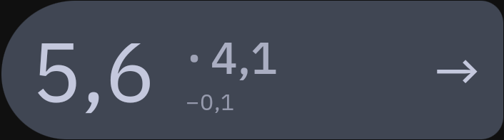
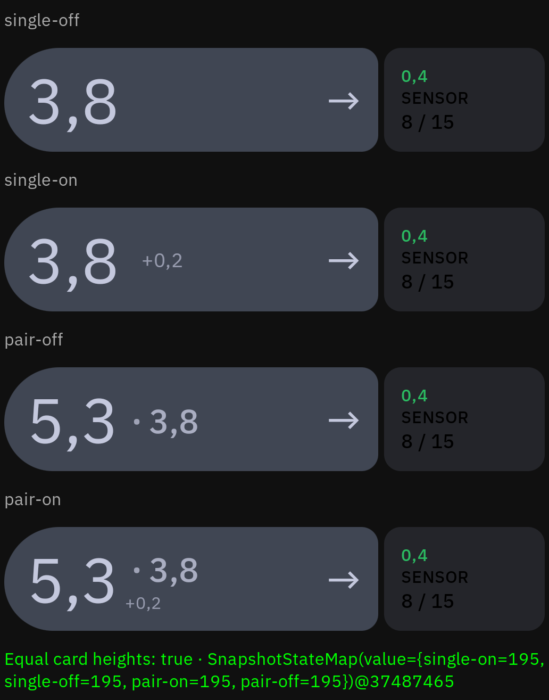
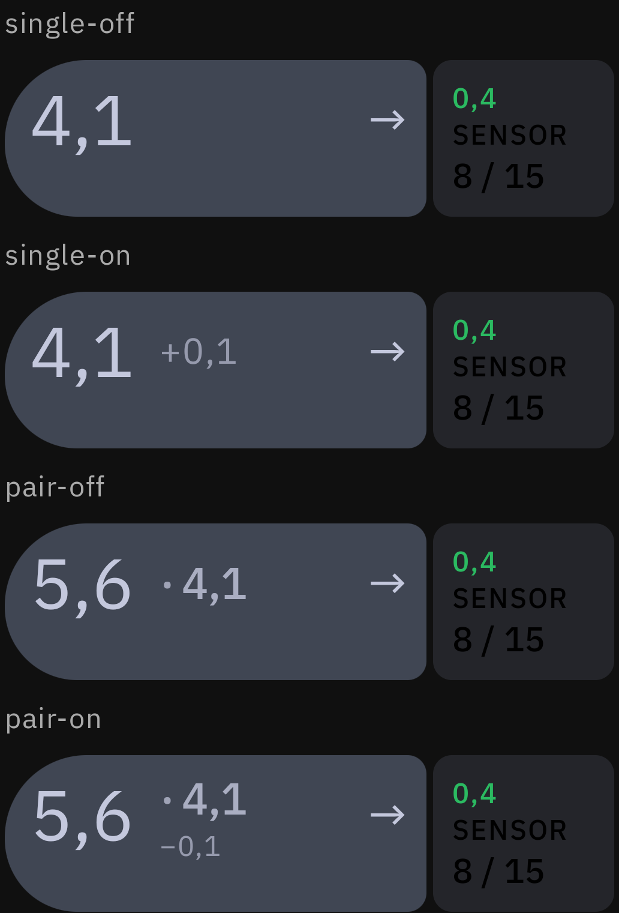

# Hero delta geometry

A single-value hero centers its regular body-large delta beside the primary,
with a 16dp gap. Two- and three-value heroes place the smaller delta beneath
the trend arrow, in both portrait and landscape. A constrained single-value
hero also uses the arrow area. The two-value reading retains its original
8dp main-to-dot and 4dp dot-to-secondary gaps, with delta on or off.

## Current validation

Mobile debug compilation passes after routing two-value delta to the existing
`HeroTrendWithDelta` in both orientations. The reading cluster receives no delta
in two-value mode, so its dot and secondary retain their normal vertical
alignment as well as their original horizontal spacing.

The screenshots below record the earlier below-dot iteration; they do not
represent the final arrow placement.

## Earlier render check, 2026-10-17

The production `HeroReadingLayout.kt`, `AppTypography`, and bundled IBM Plex font
were compiled into a separate synthetic preview, rendered in an isolated API 36
Android emulator. The preview shell uses placeholder sensor content and a text
arrow; it does not exercise the full dashboard or any sensor APIs.

The comparison exercises the same intrinsic-height card row with one or two
values and delta disabled or enabled. All four cards measured 195px high at
normal text size and 261px at 150% text size. Enabling delta added zero height
at either setting. These measurements apply to the synthetic shell, not every
complete dashboard configuration.

`HeroReadingLayoutTests` verifies measured and intrinsic height invariance across
three glyph sizes, dot/secondary baseline alignment, delta placement below the
support line in LTR/RTL, the original 8dp/4dp reading gaps with delta on and off,
and preservation of the primary's width. All four tests and the mobile debug
compilation pass.
