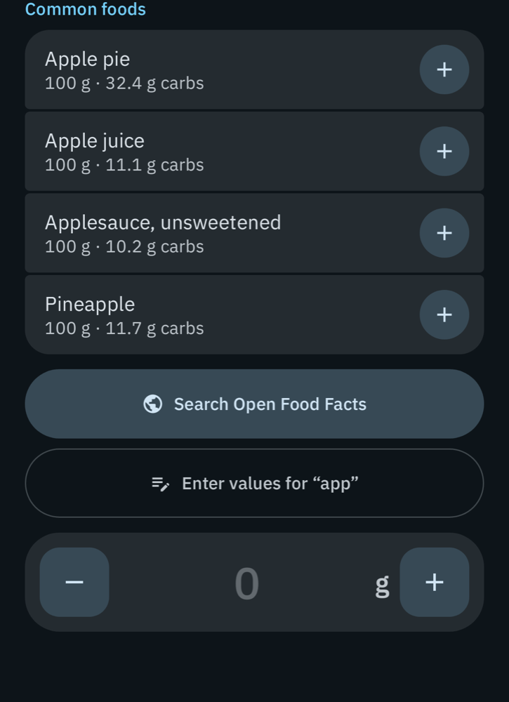
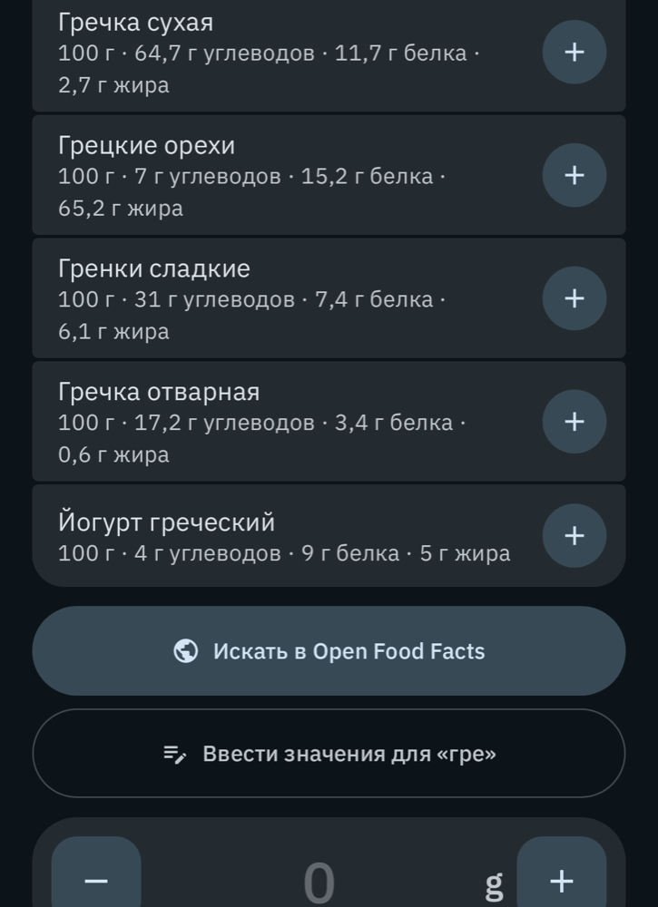
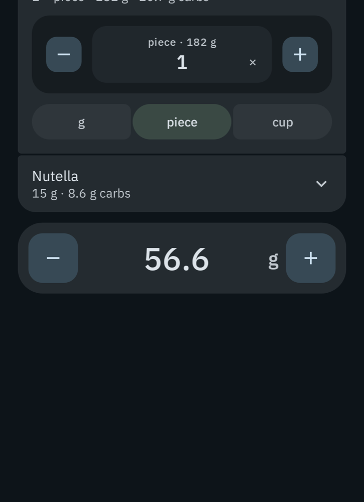
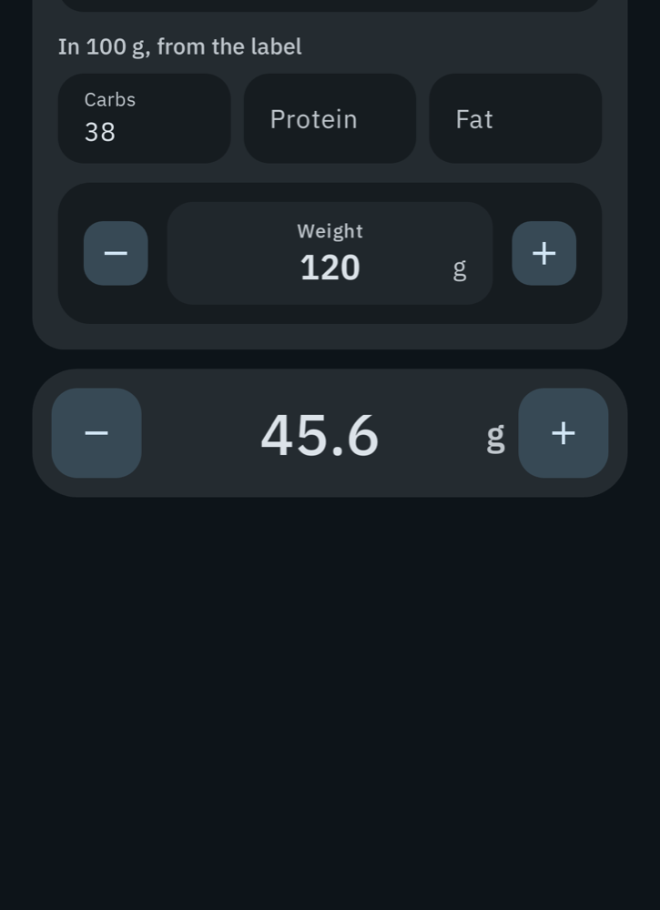
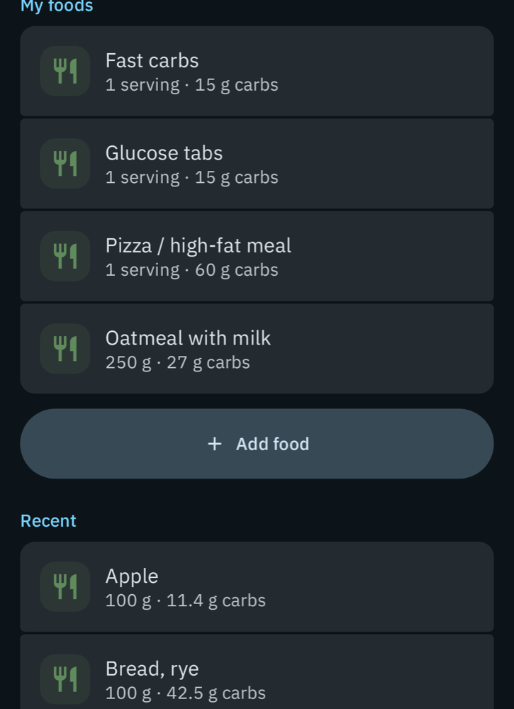
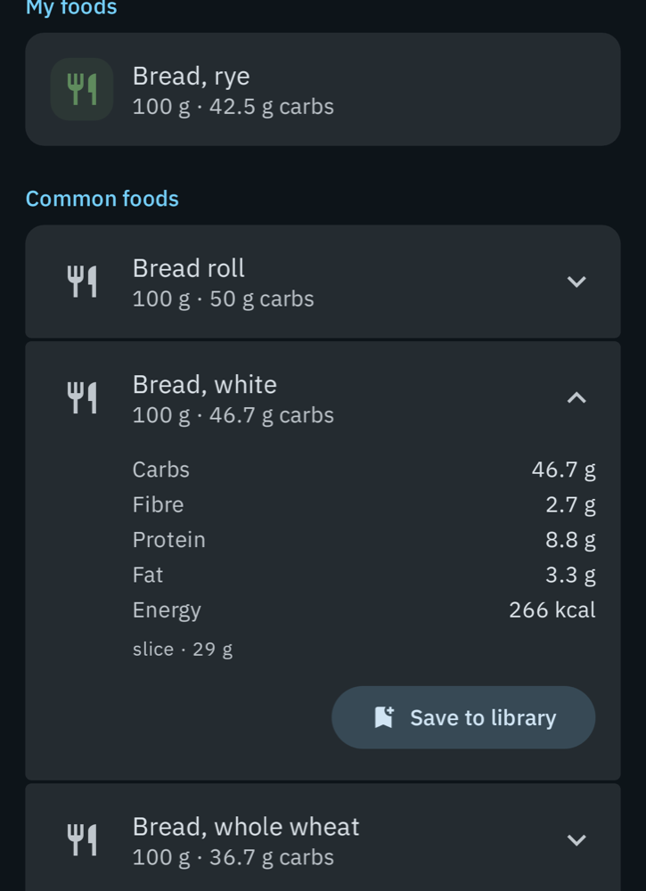

# Food library

How the journal finds foods, where the numbers come from, and the file format for bringing
your own table in.

## Where a food can come from

| Shelf | What it is | Language | Network |
|---|---|---|---|
| My foods | Foods you saved, and the ones remembered from earlier meals with the amount you ate | yours | no |
| Common foods | 232 everyday foods with household measures (a slice, a piece, a glass) | all 16 app languages | no |
| Open Food Facts | Packaged products, by search or by barcode | whatever is on the label | yes, on request |
| Food tables | The UK composition tables Juggluco has always carried, about 2,900 foods | English | no |

Nothing is sent anywhere until you press **Search Open Food Facts** or scan a barcode. Then
the typed words, or the barcode, go to openfoodfacts.org, with nothing about you. The switch
for it is under Settings → Journal → Food library → Sources.

Carbohydrate is counted the way a European label counts it: without the fibre.

## Sources and licences

- **Common foods**: USDA FoodData Central, SR Legacy (public domain). The values are not typed
  by hand: `tools/foods/build_staples.py` reads the USDA download and writes
  `Common/src/mobile/assets/foods/staples.tsv`. `tools/foods/staples_sources.psv` says which
  USDA record and which household measures each food uses; `tools/foods/staples_names.psv`
  holds the names. To add a food, add a line to both and run the script.
- **Open Food Facts**: © Open Food Facts contributors, Open Database License. Read through the
  project's public API.
- **Food tables**: McCance and Widdowson's Composition of Foods Integrated Dataset, compiled
  into the native library by upstream Juggluco.

## Importing your own table

Settings → Journal → Food library → Import reads a CSV or JSON file and adds its rows to My
foods. A food whose name you already have is replaced; everything else is added. Export
writes the same format, so an export is also a template.

```csv
name,carbs,protein,fat,per_grams,portions,absorption_min,fiber,kcal,brand,barcode
Borscht,4.3,1.1,2.2,300,,,,,,
Buckwheat with butter,17.2,3.4,2.6,100,serving:200,,,,,
Glucose tablets,15,,,,,25,,,,
```

Only `name` and `carbs` are required.

| Column | Meaning |
|---|---|
| `name` | The food's name |
| `carbs`, `protein`, `fat`, `fiber` | Grams in the amount `per_grams` says |
| `per_grams` | The weight the numbers are for. Leave the column out and they count as per 100 g; leave one cell empty and that row is "one serving" with no weight |
| `portions` | Measures to count the food in: `kind:grams`, comma separated, with kinds `piece`, `slice`, `cup`, `glass`, `tbsp`, `tsp`, `serving`, `package` |
| `absorption_min` | How long the food takes, 15–480 minutes. Estimated from the macros when left out |
| `kcal`, `brand`, `barcode` | Optional |

The reader is lenient about what a hand-made table gets differently: the columns can be in
any order, cells can be separated by commas, semicolons or tabs, decimals can use a comma
(when the cells are not comma separated), and the common column names in other languages are
understood (`Название; Белки; Жиры; Углеводы; Порция`). JSON works too, as a list of objects
with the same names:

```json
[
  {"name": "Syrniki", "carbs": 18.5, "protein": 17, "fat": 9, "per_grams": 100},
  {"name": "Kefir", "carbs": 4, "per_grams": 250}
]
```

## How it looks

Rendered from the Compose code (Robolectric), not from a device.

| Search | In Russian, with protein and fat | The meal |
|---|---|---|
|  |  |  |

| From a label | Library | A food from a shelf |
|---|---|---|
|  |  |  |
