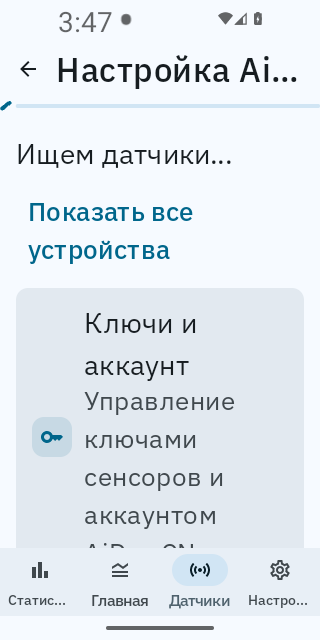
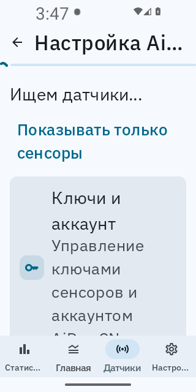
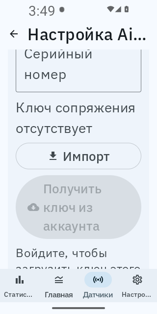

# Narrow screens and large fonts

The reported AiDex scan row gave its filter button first claim on the row width,
then laid out the weighted heading in the remaining sliver. A long translation or
large font could turn the heading into a column of individual letters and squeeze
the results list to zero height.

`AdaptiveTrailingRow` keeps a useful reading width and places the action underneath
when needed. AiDex, Anytime and MQ share a scan header; the Ottai scan heading,
shared settings/switch/expandable/master rows, preset selectors and numeric controls
use the same adaptive layout. AiDex scan controls, results and key management share
one lazy list, allowing the entire screen to scroll.

The source audit also covered weighted action pairs, fixed text-control heights,
shared choice groups, setup status screens, and position-based journal menus.
Account, key, export and date actions now wrap; text controls use minimum heights;
connected buttons grow to their content while keeping a common height. Setup status
content scrolls. Journal menus use the existing dense-surface font cap and bound
chart-menu width to the window. The UI guardrail rejects fixed heights on phone
text buttons and fields, with parser regressions in the CI guardrail job.

## Verification

- Java 21: all **4,420 mobile JVM tests passed**, including five native-rendered
  Compose regression tests. The new suite checks readable text bounds, filter
  toggles, shared switch interactions, RTL placement and growing connected labels.
- Header matrix: 240, 288, 320, 360 and 600 dp; density 1, 1.5 and 2; font scales
  1, 1.3 and 2; app typography and a wider bold serif variant.
- Every shipping locale, both translated filter states, at 240 dp and 2× text.
- Final debug APK built; mobile release Kotlin compiled; UI guardrails and six
  guardrail parser tests passed; `git diff --check` passed.
- Android 13 emulator: final debug APK at **320×640 pixels, 160 dpi, font scale 2**,
  Russian selected through the app. Both scan-filter states and opening/scrolling
  key management were exercised. No sensor or account was connected.

The emulator screenshots below are full app captures. OEM-specific custom fonts
and every screen/state combination have not been exhaustively rendered; the
shared components and source guardrails protect the recurring failure classes.

| Scan filter: matching sensors | Scan filter: all devices | Key actions after scrolling |
|---|---|---|
|  |  |  |
